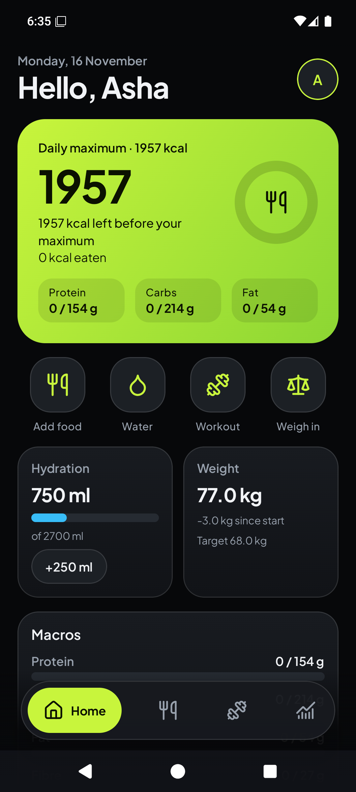
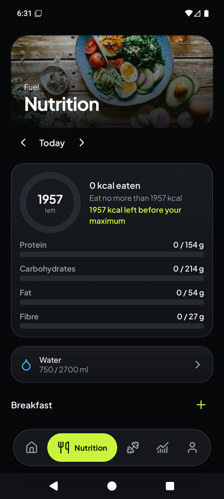
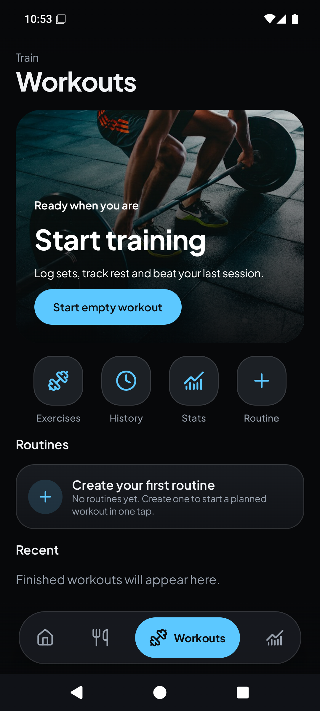
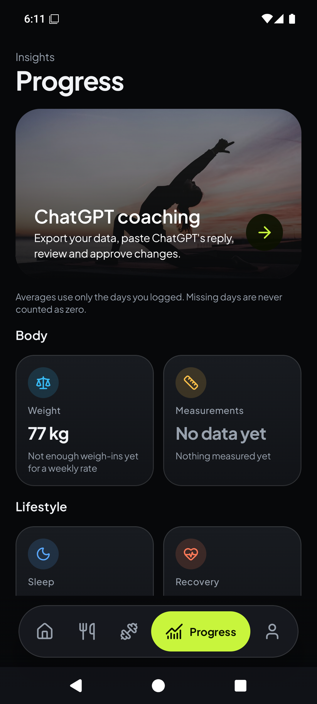

<h1 align="center">TIDE Fit</h1>

<p align="center">
  An offline, privacy-first fitness and body-recomposition tracker for Android.<br>
  No account. No ads. No analytics. No INTERNET permission.
</p>

<p align="center">
  <a href="https://github.com/ipuppyyt/tide-fit/releases/latest"></a>
  <a href="LICENSE"></a>
  
  
</p>

<p align="center">
  
  
  
  
</p>

## Why TIDE Fit

Most fitness apps want an account and your data on their servers. TIDE Fit keeps everything in a local database on your phone. The app owns and calculates your numbers, an optional AI coach only suggests, and nothing changes until you approve it.

## Features

- **Nutrition:** food log with macros, recipes, hydration, and daily targets you control.
- **Training:** exercise library, routines, live workouts with a rest timer, history and analytics.
- **Body:** weight trend, measurements, sleep, recovery and supplements.
- **ChatGPT coaching:** export your data as JSON, paste the reply back, preview it, then apply new targets. Nothing is written without your approval, and every change can be rolled back.
- **Health Connect:** two-way sync for weight, hydration, nutrition and exercise.
- **Streaks:** home streak pill, calendar, reminders and milestone notifications.
- **Widgets:** Today, Calories, Water, Workout and Streak.
- **Backup and restore** to a file you choose.

## Install

Download the latest `TIDE-Fit-*.apk` from [Releases](https://github.com/ipuppyyt/tide-fit/releases/latest) and open it on your phone (Android 10 or newer). Android will ask you to allow installs from your browser or file manager.

> TIDE Fit is an early release. Keep backups of data you care about.

## Privacy

- No INTERNET permission: the app cannot send your data anywhere.
- Data lives in a local Room database. Android cloud backup and device transfer are disabled.
- Optional permissions, all granted through system dialogs: notifications, and Health Connect read/write.
- Backups are files you choose to save. They are not encrypted.

See [SECURITY.md](SECURITY.md) for reporting vulnerabilities.

## Build from source

Requirements: JDK 17 and the Android SDK (compileSdk 37).

```bash
git clone https://github.com/ipuppyyt/tide-fit.git
cd tide-fit
./gradlew testDebugUnitTest   # run the unit tests
./gradlew assembleDebug       # build the debug APK
```

A signed release needs a `keystore.properties` file in the repo root with `storeFile`, `storePassword`, `keyAlias` and `keyPassword`. Without it the release build is unsigned. Never commit that file or your keystore.

## Tech

Kotlin, Jetpack Compose (Material 3), MVVM with unidirectional data flow, Hilt, Room, DataStore, WorkManager, Health Connect, kotlinx.serialization. Single `:app` module layered as `core`, `domain`, `data` and `feature`. Business logic is pure Kotlin in `domain/calc`.

Architecture, database design and the ChatGPT JSON contract are documented in [DEVELOPMENT.md](DEVELOPMENT.md).

## Roadmap

Ideas and open tasks are tracked in [todo.md](todo.md).

## Contributing

Issues and pull requests are welcome. Please read [CONTRIBUTING.md](CONTRIBUTING.md) first.

## License

[MIT](LICENSE) © 2026 Artis Horizon

TIDE Fit gives estimates, not medical advice. Talk to a professional before making big changes to your diet or training.
